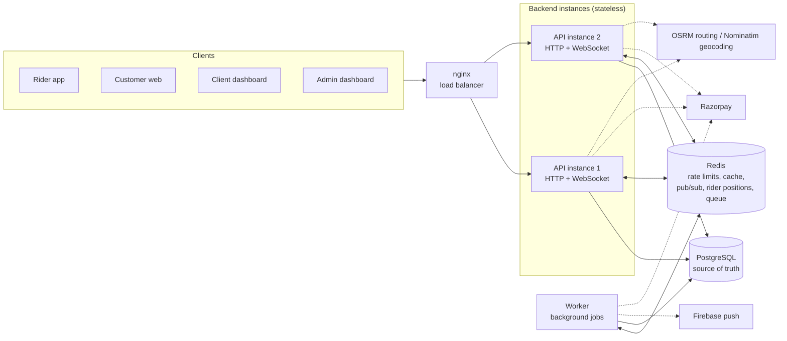
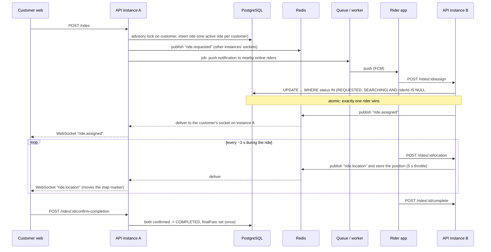
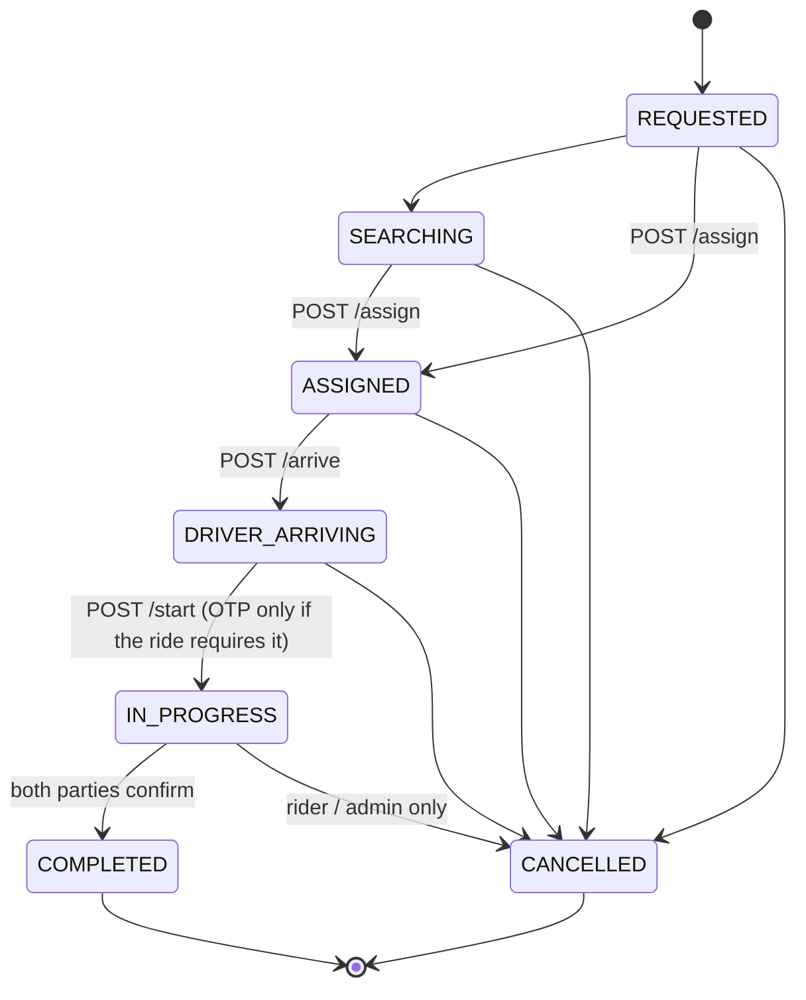

# UrbanRide: system design

This document describes the system **as built**. Where something is a limit or a trade-off it says so.
Diagrams are Mermaid (they render on GitHub).

## 1. What it is

A ride-hailing platform with four clients sharing one backend:

| Client | Users | Tech |
|---|---|---|
| Rider app | drivers | React Native (Expo) |
| Customer web | passengers | React + Vite |
| Client dashboard | companies booking rides for employees (multi-tenant) | React + Vite |
| Admin dashboard | platform operators | React + Vite |

Backend: Node.js (no web framework), PostgreSQL via Prisma, WebSockets (`ws`), Razorpay payments,
Firebase push notifications, optional Redis (rate limits, cache, pub/sub, queue).

## 2. Architecture

Key properties:

- **PostgreSQL is the only source of truth.** Everything in Redis can be lost without losing rides, payments or accounts.
- **API instances are stateless** apart from small in-memory caches, so you can add instances behind the load balancer.
- **Redis is optional in development/single-instance mode.** Without `REDIS_URL`, jobs and non-security features use their single-process behavior. In production, shared authentication, registration and OTP limits return HTTP 503 if Redis is missing or unreachable; they do not weaken to per-instance counters.

## 3. A ride, end to end

### State machine

Each arrow is an atomic compare-and-set in SQL (`UPDATE ... WHERE id = ? AND status IN (allowed predecessors)`),
so two concurrent requests can never both succeed. The generic `PATCH /rides/:id` can only set
`SEARCHING` or `DRIVER_ARRIVING`; every state with extra rules has its own endpoint.

## 4. Data model (main tables)

| Table | Purpose | Notable indexes |
|---|---|---|
| `User` | all accounts (CUSTOMER, RIDER, CLIENT_ADMIN, ADMIN); `active`, `isOnline`, `tenantId` | unique username |
| `CorporateAccount`, `CorporateEmployee` | tenants and their employees | unique access code |
| `Ride` | the ride and its timestamps, fares, `corporateAccountId` | `(customerId, requestedAt DESC)`, `(riderId, status)`, `(corporateAccountId, requestedAt DESC)`, `(status, requestedAt)` |
| `Payment` | one per ride, Razorpay ids, status | unique `rideId`, unique Razorpay ids |
| `RideStartOtp` | hashed, expiring start code | unique `rideId` |
| `RideRating`, `RideChatMessage`, `SupportConversation`, `SupportMessage` | ratings, chat, support | `(rideId, createdAt)` for chat |
| `RiderDeviceToken` | FCM tokens | unique token |

Money is `Decimal` in the database. (Known gap: no foreign keys on `Ride.customerId/riderId`.)

## 5. Authentication and authorization

- Login returns an **HMAC-signed bearer token** (8 h) containing the principal. `AUTH_SESSION_SECRET` must be identical on every instance.
- Stateless tokens cannot be revoked, so every request also checks that the user is still `active`
  (cached ~30 s, per process). A suspended user loses access within about 30 s.
- Passwords: scrypt with a random salt per password. Legacy hashes still verify and are upgraded at login.

| Role | Can access |
|---|---|
| `CUSTOMER` | own rides, payments, chat, ratings |
| `RIDER` | rides assigned to them, open requests nearby (only while online), own location uploads |
| `CLIENT_ADMIN` | **only rides and employees of their own company** (resolved server-side from the token, never from the request) |
| `ADMIN` | everything |

One function (`canAccessRide`) decides ride access for HTTP; one function (`canReceiveRideEvent`) decides
who receives each WebSocket event. Both have tests, including company A vs company B against a real database.

## 6. Consistency and concurrency

| Problem | How it is prevented |
|---|---|
| Two riders accept the same ride | atomic `UPDATE ... WHERE status IN (...) AND riderId IS NULL`; the loser gets `RIDE_ALREADY_ASSIGNED` |
| Double-tap / two devices create two active rides | per-customer advisory lock (`pg_advisory_xact_lock`) around "check active ride, then insert" |
| Both completion confirmations arrive together | one transaction; the row lock serializes them; the completion event fires exactly once |
| Two instances run housekeeping at once | each step is a compare-and-set; only one instance wins each ride |
| Double refund | `CAPTURED -> REFUNDED` is claimed atomically before calling the provider |
| Duplicate Razorpay orders | in-process lock plus unique constraint fallback |

## 7. Real time

- WebSocket at `/ws`: a client must authenticate within 10 s, messages are limited to 16 KiB, the server pings
  every 30 s and drops dead sockets, closes sockets of deactivated users, and closes any socket after 8 h.
- A socket is connected to **one** instance, but the request that causes an event may reach **another**.
  Each instance therefore publishes every event to a Redis channel and delivers events from other instances to
  its own sockets (it ignores its own messages).
- Live location: rider POSTs a position every ~3 s; it is pushed to the customer, and stored in memory plus Redis
  (written at most every 5 s per rider, expires after 2 min) so any instance can answer "where is the rider?".
- The customer app polls the ride every 5 s as a safety net for a missed event.

## 8. Rate limiting, caching, queues and background jobs

| Feature | Where it lives | Without Redis |
|---|---|---|
| Login / registration / OTP limits | Redis (shared by all instances) | HTTP 503 in production; local memory only outside production |
| Coarse per-IP API limit, chat, location uploads | memory (cheap) | same |
| Route and geocoding cache | memory L1 + Redis L2 | memory only |
| Rider positions | memory + Redis | memory only |
| Cross-instance WebSocket events | Redis pub/sub | local delivery only |
| Push notifications, refunds, maintenance | BullMQ queue + worker | run in-process only when Redis is not configured |

Queue details: one queue, jobs `ride-push` (retried only if *every* device failed), `refund` (5 attempts, exponential
backoff, one job per ride via `jobId`), `maintenance` (repeatable, so it runs once per interval across the whole fleet).
Maintenance cancels ride requests nobody accepted within 15 min and completes rides the rider finished but the customer never confirmed.

Resilience: external calls have timeouts; the routing and geocoding calls sit behind a **circuit breaker**
(after 3 failures they are skipped for 30 s) and routing falls back to a straight-line estimate, so a
routing outage does not block bookings.

## 9. Failure modes

| What fails | What happens |
|---|---|
| Redis unreachable | production shared auth/OTP limit requests fail with 503; cache reads miss; event fan-out is local; queue submission retries with the same job ID and never runs inline after an uncertain add |
| One API instance dies | nginx stops sending it traffic after 2 failures; its WebSocket clients reconnect (with backoff) to another instance |
| Routing server down | straight-line fare estimate; breaker avoids per-request timeouts |
| Geocoder down | 502 immediately (no fake addresses) |
| Push provider down | job retried; a failed push never fails the booking |
| Payment provider down during refund | refund job retried with backoff; claim is reverted so it can be retried |
| Postgres down | `/ready` returns 503; requests fail (it is the source of truth) |

## 10. Capacity (back-of-envelope: an estimate, not a measurement)

- One active ride sends a GPS update every ~3 s, i.e. 0.33 requests/s plus one Redis publish.
  1,000 simultaneous rides is therefore roughly 330 location writes/s, which is well inside what one Node process and
  one Redis handle, but it is also the dominant load: it is why the location path is rate-limited and throttled.
- Measured on a small sandbox VM, one instance, local Postgres, 30 connections (see `backend/loadtest`):
  `/health` about 11,500 requests/s; an authenticated DB read (`GET /rides/customer`) about 750-850 requests/s
  (p97.5 ~75 ms); `/ready` (one DB round trip) about 2,400 requests/s.
  These numbers depend entirely on the machine; use `pnpm loadtest` on yours and compare one instance against two behind nginx.
- The first limit you will hit is Postgres (connections and the ride queries), then the single Redis;
  the indexes in section 4 exist for those queries.

## 11. Security summary

Rate limits (login per IP and per account, OTP attempts, registration), request size limits, strict CORS in production,
signed sessions with an `active` re-check, tenant isolation for companies (HTTP and WebSocket), start-OTP rules unchanged
(required only for rides that ask for it, 5 wrong attempts per 10 min), parameterized SQL only, secrets never logged.

## 12. Trade-offs and what comes next

- Single Postgres (no read replicas yet). Reports use SQL aggregates and capped lists, not materialized rollups.
- Rider positions are per-process memory plus Redis; a real fleet would use a geo index (Redis GEO or PostGIS) for "nearest riders".
- Rider acceptance uses a PostgreSQL advisory transaction lock keyed by rider ID, then checks for another active ride and compare-and-sets the selected ride. A Redis outage cannot allow one rider to claim two rides.
- Refunds transition through `REFUND_PENDING`; only a provider-confirmed response or refund webhook sets `REFUNDED`. Ambiguous retries reuse the same Razorpay refund idempotency key. Pushes use a per-event idempotency claim; delivery is at-most-once because FCM cannot confirm whether a timed-out send reached a device.
- Dispatch is "notify nearby online riders, first to accept wins". It has no ranking, no sequential offers and no automatic re-dispatch after a rider cancels.
- No cash payments, no payout/commission model, no foreign keys on rides, rider KYC missing.
- WebSocket fan-out is one Redis channel for all events; at large scale it would be partitioned (per city / per ride).
